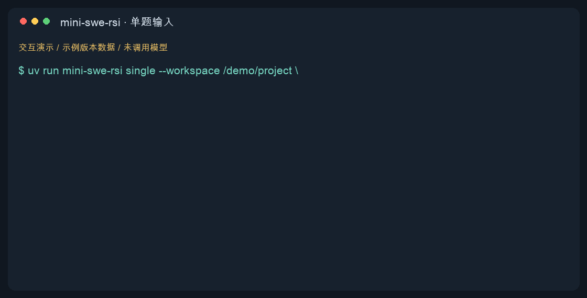

# mini-swe-rsi

[English](README.md) | 简体中文

基于 [mini-swe-agent](https://github.com/SWE-agent/mini-swe-agent) 和 [SICA](https://github.com/MaximeRobeyns/self_improving_coding_agent) 的在线 RSI 框架：让 agent 在解题后修改自己的 Harness，再通过独立检查决定是否采用新版本。整个过程使用同一个模型。

每轮先完成一道编程任务，再分析执行轨迹。支持 SWE-bench 测评和本地项目的自由文本任务。诊断支持改进时，agent 设计方案、修改代码、提交候选；宿主重测候选，通过后由新版本继续下一题。没有可执行改进时，直接进入下一题。

## 安装

需要 Python 3.12、[uv](https://github.com/astral-sh/uv) 和 Docker。ARM 主机还需支持运行 linux/amd64 容器。

在仓库根目录执行：

```bash
uv sync --locked
uv venv .eval-venv
uv pip install --python .eval-venv/bin/python -r evaluator.lock.txt
uv pip install --python .eval-venv/bin/python --no-deps .
docker build -t mini-swe-rsi-runtime:0.1 runtime
```

上游源码已集成在仓库内，安装时无需下载源码。`.eval-venv` 用于独立评分。来源版本及依赖见 [upstream.lock.json](upstream.lock.json)、[uv.lock](uv.lock)、[容器依赖](runtime/requirements.lock) 和 [评分依赖](evaluator.lock.txt)。

## 快速开始

将 [.env.example](.env.example) 复制为 `.env`，填写服务地址、密钥和模型名。

准备数据后，先运行一题：

```bash
uv run mini-swe-rsi online --run runs/lite-smoke --data data/swe-bench-lite --split test --task-limit 1
```

数据准备方法见下面的[测评](#测评)。已有数据目录的格式见[数据要求](docs/architecture.zh-CN.md#数据要求)。

新建和继续运行时均必须指定 `online --data PATH`，不再提供默认数据目录。

`--task-limit N` 选择当前 split 原顺序的前 N 题，省略时运行整个 split。`--split` 省略时采用数据清单默认值。每次新实验使用独立的 `--run` 目录。

## 本地单题输入

指定代码目录和验收命令，启动后输入需求：

```bash
uv run mini-swe-rsi single \
  --workspace /path/to/project \
  --check 'python -m unittest discover -s tests -v'
```

代码会复制到隔离容器的 `/testbed`，原目录不会被修改。运行目录和版本库必须放在 `--workspace` 之外；不要把本项目根目录直接作为输入而沿用根目录下的默认保存路径。默认镜像 `mini-swe-rsi-runtime:0.1` 支持 Python 标准库和 unittest，但不包含 pytest。其他项目用 `--image IMAGE` 指定包含 bash、git 和项目依赖的本地 Linux 镜像。容器无法联网安装依赖。

如果已有单题晋升版本，CLI 会**先询问原始版本或晋升版本，再询问编程任务**。选择晋升版本后按编号从新到旧列出，可输入完整编号，例如 `V000003`；直接回车选择最新版本。原始版本始终来自仓库集成的初始 Harness。



*交互演示使用示例版本数据，未调用模型。*

脚本调用可显式给出版本和需求，跳过交互：

```bash
uv run mini-swe-rsi single \
  --workspace /path/to/project \
  --check 'python -m unittest discover -s tests -v' \
  --version original \
  --prompt '修复空输入时的解析错误，并补充回归测试'
```

`--version V000003` 使用指定晋升版本。`--store PATH` 指定独立版本库，默认 `runs/single-input/`；单题晋升版本保存在其中的 `versions/Vxxxxxx/`，每次执行记录保存在 `executions/`。它们与 SWE-bench 测评版本互不混用。`--run PATH` 可指定尚不存在的运行目录；每条新需求使用新目录。已保存版本带有来源、父版本和源码摘要；框架代码变化后不兼容的版本会被拒绝加载。

### 独立验收与结果

每次验收都从相同的输入快照启动新容器，应用本次解题补丁后，在 `/testbed` 执行 `--check`。退出码为 0 表示通过，默认超时 300 秒，可用 `--check-timeout SECONDS` 调整。通过任务验收并不保证晋升：仍需完成现有 RSI 诊断、改进及候选检查；没有可执行改进时跳过，不保存新版本。单题模式的候选必须通过任务验收，才有资格晋升。

建议使用独立验收脚本，而不是仅依赖 agent 能修改的项目测试：

```bash
uv run mini-swe-rsi single \
  --workspace /path/to/project \
  --verify-file /path/to/acceptance.py \
  --check 'python /verification/verify'
```

`--verify-file` 的内容在运行开始时冻结，只在验收容器中以 `/verification/verify` 只读挂载；即使该文件在代码目录中，也不会复制给解题容器。普通 `--check` 的可信程度取决于命令实际检查的内容。

快照不包含 `.git`、`.env*`、虚拟环境、`node_modules` 及常见 Python 缓存，不支持符号链接。镜像中的依赖应安装在 `/testbed` 之外。输入源码快照和验收命令会保存在运行目录，运行镜像留在本机以便核对。

每次执行会打印运行目录，可用 `mini-swe-rsi report --run PATH` 查看报告。首次作答的补丁位于 `tasks/0001-single-task/patch.diff`，候选复测补丁保存在 `proposals/` 下对应的 `check/attempt_*/patch.diff`；验收日志位于 `private/`。检查报告后，再将需要的补丁应用到自己的项目。

## 测评

### 完整 SWE-bench Lite

官方 [SWE-bench Lite](https://www.swebench.com/lite.html) 的 test split 包含 300 题。先从 Hugging Face 准备任务数据：

```bash
uv run mini-swe-rsi prepare \
  --dataset SWE-bench/SWE-bench_Lite \
  --split test \
  --data data/swe-bench-lite
```

`prepare` 使用 `.eval-venv` 中的 datasets 库，保存原始任务、顺序和来源摘要；不调用模型，不下载任务镜像。需要指定数据版本时加 `--revision COMMIT`。目标数据目录必须尚不存在。

然后运行完整 test split；不要添加 `--task-limit`：

```bash
uv run mini-swe-rsi online \
  --run runs/lite-test \
  --data data/swe-bench-lite \
  --split test
uv run mini-swe-rsi report --run runs/lite-test
```

开始前建议先完成上面的单题检查。完整测评必须使用新运行目录，不能扩大已冻结的单题运行范围。首次运行会为选中的任务准备相应官方 linux/amd64 镜像，并记录镜像摘要；完整 300 题需要相应的下载时间和磁盘空间。

### 其他数据

`--dataset` 也接受其他 SWE-bench 格式的 Hugging Face 数据集，或本地 JSON／JSONL 任务文件。例如：

```bash
uv run mini-swe-rsi prepare \
  --dataset /path/to/tasks.jsonl \
  --split test \
  --data data/custom
uv run mini-swe-rsi online --run runs/custom --data data/custom --split test
```

本地 JSON 应是任务对象列表，JSONL 每行一个任务。记录需包含 `instance_id`、`repo`、`base_commit`、`version`、`problem_statement`、`test_patch`、`FAIL_TO_PASS` 和 `PASS_TO_PASS`。仓库／版本必须被内置 SWE-bench 评分器支持，并有对应官方任务镜像；通用问答或任意代码数据不能直接使用这一评分入口。

### 成绩如何统计

报告的 `evaluation` 字段统计每题**首次作答**：`selected_tasks` 是计划题数，`scored_tasks` 是已评分题数，`resolved_tasks` 是通过数。全部选定题目评分结束后，`resolved_rate = resolved_tasks / selected_tasks`；未完成时为 null。候选复测与机制检查另行保存，不增加通过题数。

这里执行的是逐题在线 RSI 测评，Harness 会在题目之间更新。使用 test split 不会将它变为固定 Harness 的独立测试成绩；对外报告时应注明在线更新方式、数据版本、任务顺序与模型设置。

## 查看结果与继续运行

生成报告不需要模型服务：

```bash
uv run mini-swe-rsi report --run runs/lite-smoke
```

报告写入 `online_report.md` 和 `online_report.json`，包含任务得分、候选接受／拒绝／跳过情况、模型调用和 token 用量。源码版本位于 `versions/`，宿主决定位于 `decisions/`。

继续已有运行时使用相同的参数：

```bash
uv run mini-swe-rsi online --run runs/lite-smoke --data data/swe-bench-lite --split test --task-limit 1
```

已完成的任务不会重跑。原目录的题目范围、源码、模型和服务配置必须保持一致；已有模型工作流中断后需[显式恢复授权](docs/architecture.zh-CN.md#中断恢复)。

## 测试

```bash
uv run pytest -q
RUN_DOCKER_TESTS=1 uv run pytest -q
```

第二条命令包含 Docker 集成测试，模型服务和评分使用测试替身。要验证自己的模型服务，请运行上面的单题命令。

## 许可证

本项目采用 [MIT 许可证](LICENSE)。集成的上游代码保留其原始版权声明与许可证，详见[上游与适配](docs/upstream_adaptations.zh-CN.md)。

## 文档

- [RSI 运行机制](docs/architecture.zh-CN.md)：七步流程、候选检查、数据要求、资源限制和中断恢复。
- [上游与适配](docs/upstream_adaptations.zh-CN.md)：代码来源、许可证及与上游的差异。

当前在线协议和改进协议均为 v8。旧版本运行目录需使用对应代码版本处理。候选接任表示通过了本轮判据，跨题收益需要另行评估。
